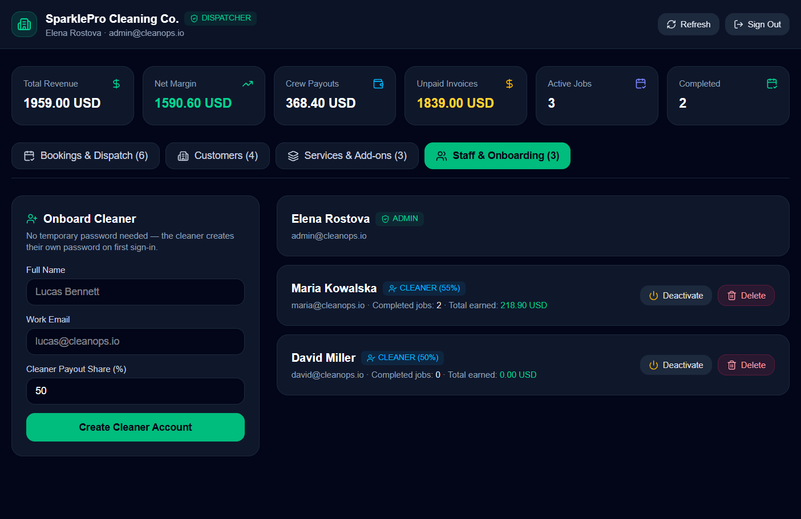
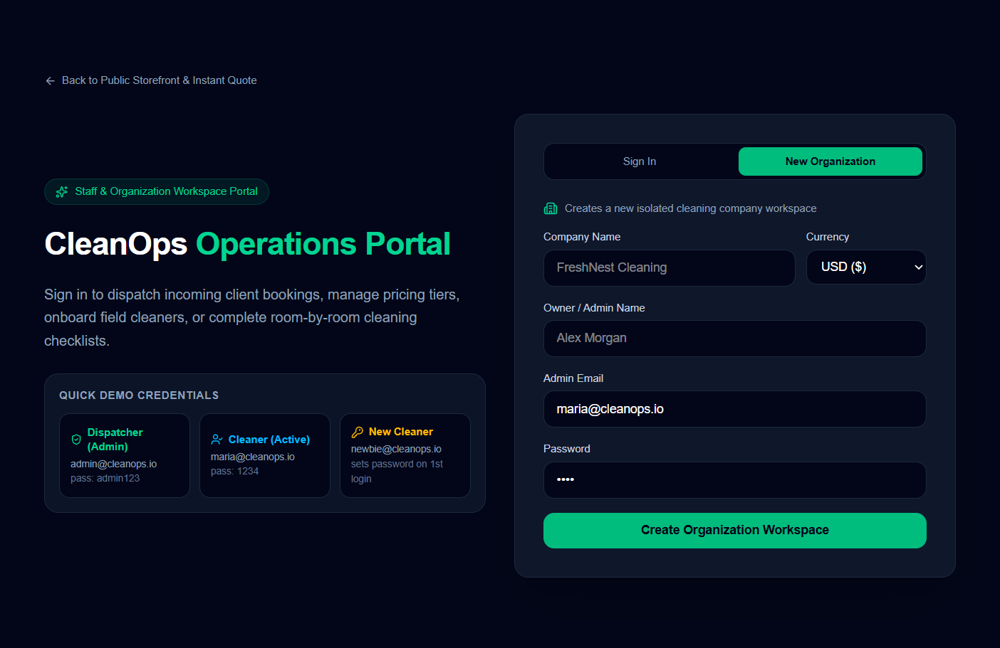

# CleanOps SaaS — Multi-Tenant Cleaning Operations Platform

A full-stack B2B SaaS platform built for residential and commercial cleaning companies. **CleanOps** connects a public self-service storefront and instant quote calculator directly to an organization-isolated dispatch center and a mobile-friendly field portal for cleaners.

## 🌐 Live Demo

- **Web App (Vercel):** `https://cleanops-saas-theta.vercel.app`
- **API Health Check (Render):** `https://cleanops-api-3k6f.onrender.com/health`

> **Note:** The backend runs on Render's free tier, so the first request after inactivity may take 20–40 seconds to wake up.

### Quick Demo Credentials (at `/login`)
| Role | Email | Password | Capabilities |
| :--- | :--- | :--- | :--- |
| **Dispatcher (Admin)** | `admin@cleanops.io` | `admin123` | Full KPIs, booking dispatch, catalog pricing, customer CRM, staff onboarding & deletion |
| **Cleaner (Active)** | `maria@cleanops.io` | `1234` | Mobile shift view, entry/access notes, interactive checklists, payout tracking |
| **New Cleaner (Onboarding)** | `newbie@cleanops.io` | *(leave empty)* | Demonstrates self-service password creation on first sign-in |

---

## ✨ Key Features

### 1. Public Storefront & Instant Quote Calculator (`/`)
- **Dynamic Pricing:** Pulls live service tiers, square-meter rates, add-ons, and checklist templates directly from the database.
- **Interactive Estimator:** Real-time calculation of total price and estimated cleaning duration based on property area ($m^2$) and selected add-on extras.
- **Self-Service Booking:** Clients submit reservations without friction; bookings land immediately in the dispatcher queue as `NEW` with auto-generated checklists.

### 2. Multi-Tenant Operations & Dispatch Center (`/admin`)
- **Strict Tenant Isolation:** Every database query is scoped by `organizationId` extracted from the verified JWT payload. Companies can self-register isolated workspaces via `/login`.
- **Executive KPIs:** Real-time tracking of Total Revenue, Net Margin, Crew Payouts, Unpaid Invoices, and Active/Completed jobs.
- **Smart Scheduling:** Built-in schedule conflict detection prevents double-booking a cleaner during overlapping time windows.
- **Frictionless Staff Onboarding:** Admins add cleaners by email without assigning temporary passwords; cleaners set their own password on first login. Safe deletion preserves historical booking records.

### 3. Mobile-First Cleaner Field Portal (`/cleaner`)
- **Job Details & Access Notes:** Displays property address, click-to-call client phone, door codes, and pet/parking instructions.
- **Mandatory Quality Checklists:** Cleaners check off room-by-room tasks in real time; the backend blocks marking a job `COMPLETED` until 100% of checklist items are verified.
- **Transparent Payouts:** Automatically calculates each cleaner's earnings based on their individual commission rate.

---

## 📸 Screenshots

### Public Storefront, Pricing & Live Calculator


### Dispatcher Control Center & Live KPIs


### Staff Roster & Passwordless Onboarding


### Mobile Cleaner Portal & Mandatory Checklists
<p align="center">
  
</p>

### Operations Portal & Multi-Tenant Workspace Registration


---

## 🛠 Tech Stack

- **Frontend:** Next.js (App Router), React, TypeScript, Tailwind CSS, Lucide Icons
- **Backend:** Node.js, Express, TypeScript, JWT Authentication, bcryptjs, Helmet, CORS
- **Database:** PostgreSQL (Neon), Prisma ORM v6 (Multi-file schema architecture)
- **Deployment:** Vercel (Frontend) + Render (Backend API)

---

## 📂 Project Structure

```text
cleanops-saas/
├── cleanops-backend/
│   ├── prisma/
│   │   ├── schema/          # Normalized multi-file Prisma schema (Organization, Customer, Catalog, Booking)
│   │   └── seed.ts          # Demo organization, staff, catalog, and sample bookings
│   └── src/
│       ├── lib/prisma.ts
│       ├── middlewares/auth.ts
│       └── routes/          # public, auth, catalog, customers, staff, bookings
├── cleanops-frontend/
│   └── src/
│       ├── app/             # / (storefront), /login, /admin, /cleaner
│       ├── components/admin/
│       ├── lib/api.ts
│       └── types/cleanops.ts
└── docs/screenshots/
